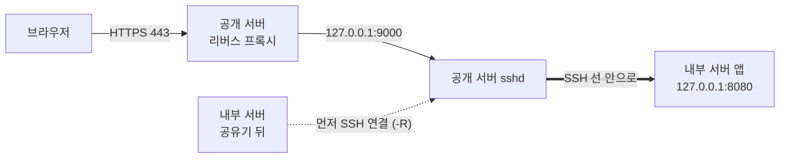
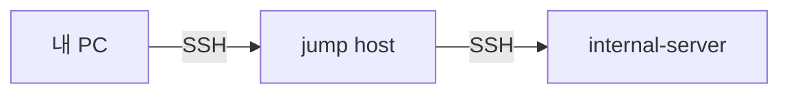

> [!summary] 한 줄
> 공유기 뒤에 있는 내부 서버에는 **밖에서 먼저 말을 걸 수 없다**. 그래서 내부 서버가 **먼저 공개 서버에 SSH 로 전화를 걸어 두고**(역방향 터널 `-R`), 공개 서버는 그 통화선으로 바깥 요청을 거꾸로 흘려보낸다. 내 PC 에서 내부 서버 화면을 볼 때는 반대로 내가 전화를 거는 쪽(`-L`)이다.



## 1. 먼저 알아 둘 다섯 가지

| 말 | 뜻 | 비유 |
|---|---|---|
| **IP 주소** | 컴퓨터의 주소 | 건물 주소 |
| **포트** | 그 컴퓨터 안에서 어느 프로그램이 받을지 (0~65535) | 건물 안 호실 번호. 443 = HTTPS, 22 = SSH |
| **듣는다(listen)** | 프로그램이 「이 주소:포트로 오면 내가 받을게」 하고 문을 여는 것 | 호실 문을 열어 둠 |
| **127.0.0.1** | 「나 자신」. 여기에만 문을 열면 **같은 컴퓨터 안에서만** 들어올 수 있음 | 집 안에서만 열리는 방문 |
| **먼저 거는 쪽** | 연결은 늘 한쪽이 먼저 건다(클라이언트). 받는 쪽은 미리 듣고 있어야 함(서버) | 전화 거는 사람 / 받는 사람 |

**왜 이게 중요한가** — 대부분의 공유기·방화벽은 「안에서 밖으로 거는 전화」는 통과시키고, 「밖에서 안으로 갑자기 오는 전화」는 막는다(NAT·방화벽). 내부 서버의 웹 앱을 127.0.0.1 에만 열어 두면 인터넷에서는 **직접 절대 못 닿는다**. 이걸 안전하게 이어 주는 게 SSH 터널이다.

## 2. SSH 와 터널

**SSH** = 암호화된 원격 접속. 원래는 「저 컴퓨터에서 명령 치기」 용인데, 그 암호화된 선 안에 **다른 연결을 실어 나를 수 있다** → 이게 터널(포트 포워딩).

- 로그인은 비밀번호가 아니라 **키**로 한다(내 PC 의 개인키 ↔ 서버 `authorized_keys` 의 공개키).
- `~/.ssh/config` 에 별칭을 적어 두면 이름만 쳐서 접속한다.

```
Host jump
    HostName jump.example.com
    User user
    IdentityFile ~/.ssh/id_ed25519

Host internal
    HostName internal-server
    User user
    ProxyJump jump
```

### 터널 세 가지

```bash
# -L (로컬 포워딩): 내 PC localhost:18080 → (SSH 선) → 내부 서버 안의 127.0.0.1:8080
ssh -N -L 18080:127.0.0.1:8080 user@internal-server

# -R (역방향): 공개 서버 127.0.0.1:9000 → (SSH 선) → 내부 서버 127.0.0.1:8080
#   내부 서버에서 실행한다
ssh -N -R 127.0.0.1:9000:127.0.0.1:8080 tunnel@relay.example.com

# ProxyJump: 직접 못 가는 서버에 점프 호스트를 한 번 거쳐 접속
ssh -J user@jump.example.com user@internal-server
```

명령 읽는 법: `-R [저쪽 주소]:[저쪽 포트]:[이쪽에서 보낼 곳]:[그 포트]`. `-N` = 명령은 안 치고 선만 유지.

| | 누가 먼저 거나 | 문(듣는 포트)이 생기는 곳 | 흔한 쓰임 |
|---|---|---|---|
| `-L` | 내 PC → 서버 | **내 PC** | 서버 안에서만 열린 관리 화면·DB 를 내 브라우저·도구로 보기 |
| `-R` | 내부 서버 → 공개 서버 | **공개 서버** | 공유기 뒤 서버의 웹 앱을 공개 서버를 통해 바깥에 내보내기 |
| ProxyJump | 내 PC → 점프 호스트 → 목적지 | (없음, 접속만) | 허용된 곳에서만 SSH 를 받는 서버에 들어가기 |



> [!tip] 헷갈릴 때
> **문이 어느 쪽에 생기느냐**만 보면 된다. `-L` = 내 쪽(Local), `-R` = 저쪽(Remote). 데이터는 어느 터널이든 양방향으로 흐른다(요청 가고 응답 옴).

## 3. 역방향 터널을 서비스처럼 굴리기

### 문을 어디에 여나
- `-R` 의 문은 기본적으로 공개 서버의 **127.0.0.1** 에만 열린다(sshd 기본값 `GatewayPorts no`).
- 공개 서버의 리버스 프록시가 도커 컨테이너 안에 있으면 127.0.0.1 로는 못 닿는다. 이때는 컨테이너가 닿는 **도커 브리지 게이트웨이 주소**(예: `172.17.0.1`)에 문을 연다. 이 주소는 인터넷에서는 안 보인다.
- 그러려면 공개 서버 sshd 에서 **터널 전용 계정에만** 허용한다.

```
# /etc/ssh/sshd_config (공개 서버)
Match User tunnel
    GatewayPorts clientspecified   # 터널을 거는 쪽이 정한 주소에 문을 열어도 됨
    AllowTcpForwarding remote      # -R 만 허용 (-L 로 공개 서버 안쪽을 엿보는 건 불가)
```

- 공인 주소(`0.0.0.0`)에는 열지 않는다. 그러면 터널 포트가 인터넷에 그대로 드러난다.

### 끊기지 않게
```bash
ssh -N \
  -o ServerAliveInterval=30 \
  -o ServerAliveCountMax=3 \
  -o ExitOnForwardFailure=yes \
  -R 127.0.0.1:9000:127.0.0.1:8080 \
  tunnel@relay.example.com
```
- `ServerAliveInterval=30` — 30초마다 「살아 있니?」 신호. 응답이 없으면 끊는다. 공유기가 조용한 연결을 몰래 끊는 것도 막는다.
- `ExitOnForwardFailure=yes` — 저쪽에 문을 못 열면(포트를 이미 누가 씀 등) 붙어 있지 말고 **실패로 끝낸다**.
- 끝난 프로세스는 다시 띄운다: `autossh`, systemd `Restart=always`, 도커 `restart: unless-stopped` 중 하나.
- 그러면 내부 서버를 껐다 켜거나 인터넷이 잠깐 끊겨도 터널이 저절로 복구된다. 복구 전 몇 초~몇십 초는 502 가 날 수 있다.

## 4. 요청 하나 따라가기

1. **브라우저 → 공개 서버 리버스 프록시 (:443, HTTPS)** — 도메인이 공개 서버 IP 로 풀리고, 프록시가 TLS 를 푼다.
2. **프록시에서 로그인 확인** — 필요하면 인증 서버에 「이 쿠키 누구?」를 묻고, 안 되면 로그인 화면으로 보낸다.
3. **프록시 → 터널 문** (예: `127.0.0.1:9000`)
4. **공개 서버 sshd → (SSH 선) → 내부 서버** — 터널 문으로 들어온 바이트를 미리 걸어 둔 SSH 선에 실어 보낸다.
5. **내부 서버의 앱(127.0.0.1:8080)** 이 응답을 만든다.
6. 응답은 **같은 길을 거꾸로** 돌아온다.

> [!note] 그래서 생기는 일
> - 내부 서버가 꺼지거나 터널이 끊기면 → 1·2 단계는 되는데 3 단계에서 막힘 → **502 Bad Gateway**.
> - 응답이 터널 하나로 다 오므로, 큰 파일을 많이 받으면 **내부 쪽 인터넷 업로드 속도**가 그대로 체감 속도가 된다.

## 5. 터널 없이 「밖으로만」 하는 통신

### 작업 일꾼(worker) — 폴링
- 내부 서버의 worker 가 주기적으로(예: 10초마다) 공개 API 에 HTTPS 로 「나 할 일 있어?」 하고 묻는다. 일이 있으면 가져와 처리하고 결과를 올린다.
- 밖으로 거는 연결이라 터널이 필요 없다. 내부 쪽에 문을 하나도 안 열어도 된다.
- 대신 작업 시작이 최대 한 주기만큼 늦다. 그래서 실시간 화면은 터널, 무거운 배치 작업은 폴링으로 나누는 게 흔하다.
- 개발·운영 환경이 같은 큐를 보면 서로 일을 가로챌 수 있다. 환경마다 worker 토큰을 따로 둔다.

### 파일 옮기기
| 방법 | 쓰임 | 안전 장치 |
|---|---|---|
| `rsync` over SSH | 정기 동기화 | 그 키로는 rsync 만 되게 강제(forced command). 키가 새도 셸을 못 얻는다 |
| `tar … \| ssh … 'tar xf -'` | 큰 폴더 한 번 옮기기 | 보내기 전 `sha256sum` 목록을 만들어 같이 보내고, 받은 쪽에서 `sha256sum -c` |

```bash
# 디스크에 임시 파일 없이, SSH 연결 한 번으로 묶어 보내고 바로 푼다
tar cf - ./folder | ssh user@internal-server 'tar xf - -C /srv/incoming'
```

```
# authorized_keys 한 줄: 이 키는 /srv/share 읽기 전용 rsync 만
command="rrsync -ro /srv/share",restrict ssh-ed25519 AAAA... sync-key
```

## 6. 안전하게 쓰는 법

- [ ] 내부 앱은 **127.0.0.1(또는 도커 내부망)** 에만 연다.
- [ ] 터널 문은 공개 서버의 **내부 주소**에만 연다. `0.0.0.0` 금지.
- [ ] SSH 는 **키 로그인만**(`PasswordAuthentication no`), 허용 IP 만(방화벽).
- [ ] 계정을 용도별로 나누고 권한을 좁힌다: 터널 계정은 `-R` 만, 동기화 계정은 rsync 만.
- [ ] 웹 앞단에서 로그인을 확인한다. 터널은 통로일 뿐 인증이 아니다.
- [ ] SSH 를 짧은 시간에 많이 열지 않는다. 서버의 차단 장치(fail2ban 등)에 IP 가 막힐 수 있다. 명령은 한 번의 SSH 로 묶어 실행한다.

## 7. 문제 생겼을 때 어디부터 보나

| 증상 | 가능성 큰 곳 | 확인 |
|---|---|---|
| 웹이 **502** | 내부 서버 꺼짐 · 터널 끊김 · 내부 앱 재시작 중 | 공개 서버에서 `ss -ltn \| grep 9000` 으로 터널 문이 열려 있는지 |
| 터널 프로세스가 계속 재시작 | 공개 서버 쪽 포트를 옛 연결이 아직 잡고 있음 → `ExitOnForwardFailure` 로 종료(코드 255) | 옛 연결이 정리될 때까지(보통 1~2분) 기다린다. 서버의 `ClientAliveInterval` 을 짧게 두면 빨리 정리된다 |
| `ssh` 가 아예 안 붙음 | 내 IP 가 바뀌었거나 막힘 · 대상 서버 꺼짐 | 다른 경로로 서버 상태부터 확인. 재시도를 반복하지 않는다 |
| 첫 요청만 아주 느림 | 내부 앱이 꺼져 있다가 켜지는 중 · 오래 쉰 연결 | 잠시 뒤 다시. 반복되면 keepalive 설정 확인 |

## 8. 다른 방식과 비교

「공유기 뒤 장비에 밖에서 닿기」는 흔한 문제라 정해진 해법이 몇 가지 있다. SSH `-R` + 자동 재시작은 그중 **가장 단순한 자작형**이고, 장비 한두 대 규모에선 흔히 쓰는 정상적인 방법이다.

| 방식 | 어떻게 | 누가 많이 쓰나 | SSH 역방향 터널과 비교 |
|---|---|---|---|
| **공유기 포트 열기** | 공유기에서 443 → 내부 서버로 넘김 | 가정·소규모 | 내부 장비가 인터넷에 직접 드러남 · 공유기 권한·고정 IP 필요 |
| **SSH 역방향 터널** (이 글) | 안쪽 장비가 밖 서버에 먼저 SSH 를 걸어 문을 엶. `autossh` 등으로 재연결 | 소규모·연구실·임시 연결 | 추가 서비스·비용 없음. 대신 포트마다 손으로 관리, 모든 트래픽이 SSH 연결 하나·업로드 속도에 묶임 |
| **관리형 터널** (Cloudflare Tunnel, ngrok, frp) | 원리는 같음(안에서 밖으로 먼저 연결). 서비스가 인증서·로그인·대시보드까지 해 줌 | 스타트업·개발팀에서 아주 흔함 | 프록시 + 인증 + 터널을 상품으로 산 것. 외부 회사로 트래픽이 지나감 |
| **VPN / 메시 VPN** (WireGuard, Tailscale, ZeroTier) | 모든 장비를 하나의 사설망에 넣어 어디서든 사설 IP 로 접속 | **관리용 접속의 요즘 표준** | 포트마다 터널을 만들 필요 없음. 장비가 늘면 이쪽이 편함 |
| **점프 서버(배스천)** | 관리 접속은 정해진 한 서버를 거쳐서만 | 기업·클라우드 표준 (AWS SSM, GCP IAP 도 같은 생각) | `ProxyJump` 가 이것 |
| **작업 큐 + 폴링** | 일꾼이 중앙에 「일 있어?」 묻고 가져감 | GPU 일꾼·CI 러너(GitHub Actions self-hosted 등) 표준 | 문을 안 열어도 돼서 가장 안전한 축 |
| **원격 데스크톱** (Chrome RD, AnyDesk, RDP) | 화면을 통째로 | GUI 작업·급할 때 | 서버 관리용이 아니라 사람 손 대신 |

> [!tip] 언제 바꾸나
> - 장비가 한두 대면 SSH 터널로 충분하다. 문 몇 개는 손으로 관리할 만하다.
> - 장비가 늘거나 관리 접속 경로가 복잡해지면 → 관리용은 **WireGuard/Tailscale** 로 묶고, 바깥 공개 웹은 터널(또는 관리형 터널)로 두는 게 흔한 다음 단계.
> - 공개 서버를 클라우드로 옮겨도 「내부 서버가 먼저 건다」 구조는 그대로 쓸 수 있다.

## 9. 미니 사전
- **리버스 프록시**: 바깥 요청을 받아 주소(Host)를 보고 안쪽 프로그램으로 넘겨주는 「안내 데스크」. nginx, Nginx Proxy Manager, Caddy, Traefik 등.
- **NAT**: 여러 컴퓨터가 공유기 공인 IP 하나를 같이 쓰는 방식. 밖에서 먼저 들어오는 연결은 어느 컴퓨터로 보낼지 몰라 막힌다.
- **UFW**: 우분투 방화벽. 「이 IP 에서 오는 22번만 허용」 같은 규칙.
- **forced command**: `authorized_keys` 에 「이 키로 들어오면 이 명령만 실행」을 적어 두는 것.
- **폴링(polling)**: 주기적으로 물어보기. 반대는 푸시(상대가 알려 줌).
- **502 / 403**: 502 = 프록시가 뒤쪽에 못 닿음, 403 = 닿았는데 거절됨.

관련: [[HTTP 1.1·2·3 와 QUIC]] · [[IDOR — id만 바꿔 남의 자료 보기]] · [[브라우저 캐시와 정적 파일]]
